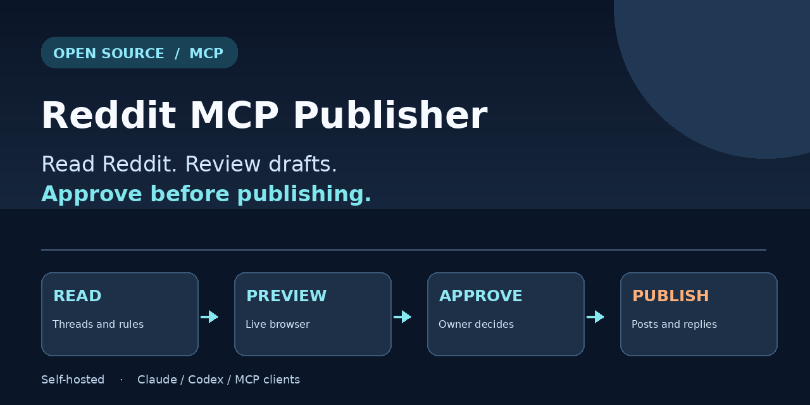
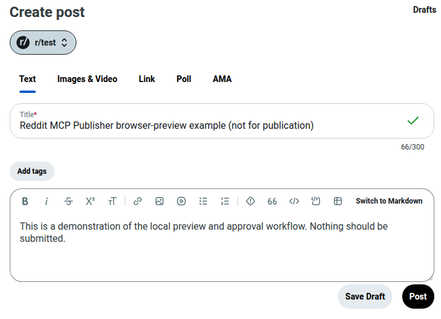

# Reddit MCP Publisher

[](https://github.com/Bl0ck154/reddit-mcp-publisher/actions/workflows/ci.yml)
[](https://www.npmjs.com/package/reddit-mcp-publisher)
[](https://registry.modelcontextprotocol.io/v0.1/servers/io.github.Bl0ck154%2Freddit-mcp-publisher/versions/0.3.3)
[](LICENSE)

**A self-hosted Reddit MCP server for AI agents that can read Reddit, preview drafts and publish with your approval.** Connect Codex, Claude Desktop, OpenCode or another MCP client to your own Reddit session. Read posts, threads, subreddit rules, inbox notifications and Reddit Chat; prepare posts, comments or DMs.

The core browser workflow uses **no Reddit developer API key**. You still need your own Reddit sign-in in Chrome/Chromium. LightPanda is optional for supported authenticated reads, while Chrome handles login, previews and publishing.

## Quick start

Requires **Node.js 22+, npm and Chrome/Chromium**.

```bash
npx -y reddit-mcp-publisher setup
```

For a specific MCP client:

```bash
npx -y reddit-mcp-publisher setup --client codex
npx -y reddit-mcp-publisher setup --client claude
```

Setup creates local MCP configuration and preserves existing browser profiles and encryption keys. Your Reddit password and cookies remain in your browser. [Read the installation guide](docs/installation.md) for desktops and headless servers.



## What it can do

| Task | What happens |
| --- | --- |
| **Read Reddit from an AI agent** | Retrieve threads, subreddit rules, flairs, own activity, inbox and notification notices |
| **Check eligibility before posting** | Check available karma and account-age requirements and block confidently ineligible destinations |
| **Publish posts, comments and replies** | Bind exact target and text, show a live browser preview, then ask for approval |
| **Reddit Chat and DMs** | Read conversations and prepare messages with verified recipients and supported attachments |
| **Handle uncertain results** | Use recorded publication state to avoid blindly repeating a write |

Reddit's moderation and automation rules still apply. Publishing may fail, and subreddit moderators can remove a post afterward. A changed browser UI or an authentication challenge can stop an operation.

## Real browser preview



*Maintainer test on 2 November 2026: the form was filled, but no post was sent.* [Reproduction steps and limits](docs/demo-live.md).

Here is an **illustrative** terminal sequence. Replace placeholders with identifiers returned by the CLI:

```bash
reddit-mcp-publisher reddit-preflight test
reddit-mcp-publisher prepare reddit-post --subreddit test --title "A tool for reviewing Reddit drafts" --body "I built a self-hosted tool. Feedback welcome."
reddit-mcp-publisher preview <draft-id>
```

After inspecting the preview and deciding to publish:

```bash
reddit-mcp-publisher approve <draft-id> --digest <preview-sha256>
reddit-mcp-publisher publish <draft-id> --approval <approval-token>
```

The publisher records publication status and the permalink when Reddit confirms submission. Approval is tied to a specific draft and destination.

## Browser MCP vs Reddit API tools

Reddit MCP Publisher operates through an authenticated browser session to handle surfaces such as Reddit Chat, notifications and the live posting composer. An API-based Reddit integration typically uses developer credentials and has a different set of supported endpoints and limits. Both must respect Reddit rules. The project is local/self-hosted: there is no public hosted account connection.

## Docs and support

- [Product overview](https://bl0ck154.github.io/reddit-mcp-publisher/) · [FAQ: Reddit MCP without an API key](docs/faq.md)
- [Install for Claude, Codex, VPS](docs/installation.md) · [Browser modes](docs/browser-modes.md)
- [Features and MCP tools](docs/features.md) · [ChatGPT Actions](docs/gpt-actions.md)
- [Maintainer demo](docs/demo-live.md) · [Migration notes](docs/migrating.md)
- [npm and MCP Registry release guide](docs/releasing.md) · [Directory listing status](docs/distribution.md)
- [Contributing](CONTRIBUTING.md) · [Security](SECURITY.md) · [Changelog](CHANGELOG.md)

Please [report bugs or share a reproducible use case](https://github.com/Bl0ck154/reddit-mcp-publisher/issues/new/choose). Independent user reports are tracked in [Showcase](docs/showcase.md). No external adoption or endorsements are claimed.

MIT licensed. Not affiliated with Reddit.
