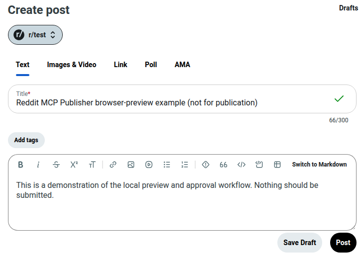

# Maintainer browser-preview check

Tested on 2 November 2026 with the maintainer's self-hosted Publisher.

## Live Reddit preview (no post sent)

The agent prepared an unpublished text post to r/test, then called the Publisher preview step. The browser opened Reddit's create-post page and filled the chosen title and body. The preview returned PREVIEWED and did not authorize or click Post.

The screenshot is cropped to exclude the signed-in account, notifications, and personal subreddit history. It is a real browser screenshot from the maintainer test, not an independent user review. **Nothing was published for this demonstration.**

To reproduce safely, use a subreddit where you have permission to draft, prepare a post, and run only the preview step. Stop before owner approval. Any Reddit post or comment created by a user remains subject to that community's rules.

## Read-only Reddit rules

During the same check, the authenticated Publisher read r/test community rules using its lightweight read backend. The tool returned the official Reddit rules endpoint:

    https://www.reddit.com/r/test/about/rules.json?raw_json=1

The response included the rule named "No onlyfans promos, and nsfw posts". This result was retrieved at the time of the test; subreddit rules can change. The operation did not send a post or mark notifications read.

## What this verifies

- A working authenticated Reddit browser preview and the expected text in the post form.
- A live, read-only subreddit rule lookup.
- No publishing took place in this test.

It does **not** prove that every subreddit accepts posts, that media uploads succeed on every Reddit UI version, or that a submitted post remains publicly visible after moderation. Those are separate checks.

For failure reports and independently operated tests, see [real-world examples](showcase.md).
